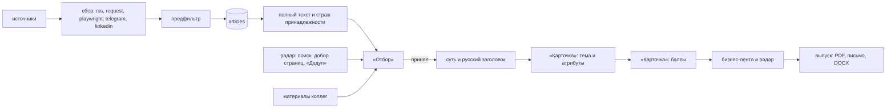

# OilTech Digest: архитектура

Как система устроена по нынешнему коду (сверено в ноябре 2026). Запуск и команды описаны в
[гиде по проекту](project_guide.md), проверка в [testing.md](testing.md), решения в
[ADR 0001](adr/0001-single-contour.md) (единый контур) и [ADR 0002](adr/0002-two-scoring-profiles.md)
(профили скоринга).

## 1. Что это за система

Платформа мониторинга нефтесервисных публикаций для заказчика. Публикации приходят тремя путями:

- сбор статей из каталога источников: RSS, листинги сайтов, браузерный сбор, открытые каналы Telegram;
- технологический радар: по расписанию ищет материалы встроенным поиском модели по 13 тематикам заказчика;
- бот Telegram «Материалы коллег» ([tg_materials_bot.md](tg_materials_bot.md)).

Каждую публикацию решает агент «Отбор»: брать или нет, категория (бизнес, технология, другое), связь с
нефтесервисом. Принятая получает суть и русский заголовок, агент «Карточка» ставит ей тему из 13 тематик и
атрибуты, а вторым вызовом баллы по профилю категории. «Дедуп» держит одно событие в одной карточке. Люди разбирают
карточки в бизнес-ленте и на технологическом радаре, отмечают «в дайджест» и собирают месячный выпуск: PDF в
формате эксперта заказчика, письмо и DOCX.

Система разнесена на два контура. Ядро (интерфейс, база, планировщик) работает в РФ. Всё, что требует зарубежной
сети (OpenAI, западные источники, Telegram Bot API), исполняют воркеры внешнего контура (NL), у которых нет своей
базы. Ядро не зовёт модель в запросе пользователя: ИИ идёт задачами через очередь. Если внешний контур недоступен,
интерфейс работает на собранных данных, задачи копятся в очереди, и сторож полос (`check-lanes`) это показывает.

## 2. Контуры и размещение

### 2.1 Ядро (РФ): `docker-compose.yml`

| Сервис | Роль | Порт |
|---|---|---|
| `caddy` | обратный прокси, HTTPS (Let's Encrypt), сжатие zstd и gzip | 80 и 443 наружу |
| `app` | FastAPI и собранный фронт `frontend/dist`, сессии, роли | 8000, только localhost |
| `db` | PostgreSQL 16: всё состояние системы | 5432, только localhost |
| `bootstrap` | разовый: `init-db`, сиды источников, тематик и критериев, `apply-source-overrides` | |
| `worker` | фоновые задачи очередей `default` и `ai` | |
| `playwright-worker` | очередь `playwright`: браузерные источники и печать PDF | |
| `scheduler` | цикл планировщика (раздел 7) | |
| `test` | `pytest` в образе с dev-зависимостями (профиль `test`) | |

`worker`, `playwright-worker` и `scheduler` стоят в профиле compose `pipeline`: голый `docker compose up -d` их не
поднимает, на сервере их выкатывает `scripts/deploy-core.sh` с явным списком сервисов (раздел 10). Наружу открыт
только Caddy.

Тома: `pgdata` (база), `exports` (выгрузки), `branding` (файл брендинга выпуска `DIGEST_BRANDING_PATH`, картинки
обложки и каталог `fonts/` со шрифтом бренда), `documents` (оригиналы загруженных документов). Брендинг и документы
общие для всех контейнеров: правку с экрана видят и `app`, и воркеры печати.

Шрифт бренда (семейства Brand Sans и Brand Sans Condensed) в репозитории не хранится. Файлы лежат на сервере в
томе брендинга, интерфейс берёт их с адреса `/brand/fonts/`, печать PDF из того же каталога
([`brand_fonts.py`](../oiltech_digest/brand_fonts.py), каталог можно задать `BRAND_FONTS_DIR`). Файлов нет: работает
запасной шрифт.

### 2.2 Внешний контур (NL): `docker-compose.external-worker.yml`

Воркеры без базы: с ядром они говорят только по HTTPS (раздел 4), настройки в `.env.external-worker`. Полосы задаёт
[`lanes.py`](../oiltech_digest/lanes.py):

| Сервис | Очереди | Что исполняет | Потоков |
|---|---|---|---|
| `external-worker` | `external-ai` | поток дня: суть и перевод ленты, «Отбор», «Суть и перевод» сигналов, «Карточка» и её баллы, судья перепечаток, разбор документов | 1 |
| `external-worker-bulk` | `external-ai-bulk` | пересчёты и повторы названных публикаций (те же агенты, без документов и перепечаток); на ядре включается `AI_BULK_LANE_ENABLED=1` | 1 |
| `external-worker-fetch` | `external-fetch`, `external-notify` | сбор запросом, дозагрузка тел; отправка кода допуска в Telegram | 3 |
| `external-worker-browser` | `external-playwright` | сбор браузером | 1 |
| `external-worker-agents` | `external-agents` | прогон радара: поиск, добор страниц, «Дедуп» | 1 |
| `tg-materials-bot` | нет | бот «Материалы коллег» | |

Ядро не ставит задачу в полосу, которая не умеет её исполнить (`lanes.check_enqueue`), и не исполняет задачу
внешней очереди у себя (`background_jobs.runs_inline`). Почему у воркеров нет доступа к базе: пришлось бы открывать
её наружу или строить VPN, при сетевых сбоях зависают соединения, труднее ограничить права и проверить, что прочитал
внешний сервер.

## 3. Конвейер

### 3.1 Общий поток



### 3.2 Сбор

Стратегию задаёт `sources.parse_strategy`:

- `rss`: [`rss_parser.parse_all()`](../oiltech_digest/ingestion/rss_parser.py);
- `request`: [`request_parser.parse_source()`](../oiltech_digest/ingestion/request_parser.py) читает `listing_url`
  (без него главную), берёт первые `REQUEST_ARTICLE_LIMIT` кандидатов (свежее первым; в `config.py` и compose 12, в
  `.env.example` 6) и вставляет те, чьего адреса ещё нет в базе;
- `playwright`: [`playwright_parser.parse_source()`](../oiltech_digest/ingestion/playwright_parser.py) для сайтов,
  которые рисуют листинг скриптами;
- `telegram`: открытые каналы через страницу предпросмотра `t.me/s/<канал>`
  ([`telegram_parser.py`](../oiltech_digest/ingestion/telegram_parser.py));
- `linkedin`: публичная страница компании `linkedin.com/company/<имя>/` без входа, только через NL
  ([`linkedin_parser.py`](../oiltech_digest/ingestion/linkedin_parser.py)). Один рендер на компанию: последние 10 постов
  берутся из разметки schema.org (полный текст и дата), посты по одному не открываются, репосты чужих авторов
  отбрасываются. LinkedIn закрывает частые заходы с одного адреса, поэтому компанию ставят не чаще
  `LINKEDIN_MIN_INTERVAL_HOURS`, за цикл не больше `LINKEDIN_SOURCES_PER_CYCLE`, задачи разнесены на
  `LINKEDIN_SPACING_MINUTES`. Стена входа или проверка Cloudflare дают `blocked:…` в итоге задачи и паузу всем компаниям
  на `LINKEDIN_BLOCK_COOLDOWN_HOURS` (`sources.external_cooldown_until`). Заводит компанию `add-linkedin-source`.

Источник с `network_region='external'` собирает воркер NL (шаг `enqueue-external-scrape` при
`FETCH_EXTERNAL_ENABLED=1`); ядро кладёт в задачу последние адреса сайта (`known_urls`), чтобы воркер не качал
известное. Новый источник не тянет архив своей ленты: статью старше `sources.collect_since` (база ставит две недели
до заведения) сбор не берёт.

Детерминированный предфильтр [`relevance_filter.should_keep_article()`](../oiltech_digest/ingestion/relevance_filter.py)
отсекает явный шум до записи, без вызовов модели, по ключевым и стоп-словам тематик заказчика.

Повторы: адрес статьи уникален (`articles.url`, ключ адреса `url_key`), `content_hash` считается по заголовку и
адресу. Перепечатки одной новости в разных изданиях ловит «Дедуп» ленты (раздел 3.5).

### 3.3 Полный текст статьи

RSS часто отдаёт только анонс: статья ложится с `text_truncated = true`, и
[`article_fetcher.fetch_full_text()`](../oiltech_digest/ingestion/article_fetcher.py) идёт по адресу за полным
текстом. Перед записью два рубежа принадлежности (`_ownership_rejection()`): значимые слова заголовка есть в теле
(`normalize.title_matches_body()`, посегментно), и такого тела нет у другой статьи источника
(`normalize.compute_body_hash()` и индекс `(source_id, body_hash)`). Отказ даёт `full_text_status = 'mismatch'` и
прежний текст не затирает. Раньше тексты сравнивались только по длине, и листинг, пейвол или чужой материал
побеждали настоящую статью со статусом `ok`.

Хвосты страницы (соседние новости, комментарии, подвал) режет
[`article_tails.py`](../oiltech_digest/ingestion/article_tails.py): при извлечении по разметке и заголовку хвоста,
при записи по повторам у других статей источника. Отрезанное лежит в `articles.text_tail`, так что
`raw_text || text_tail` равно тексту, как он пришёл.

### 3.4 ИИ-конвейер: агенты

Агенты устроены одинаково: ядро при выдаче задачи собирает самодостаточный пакет, воркер NL без базы зовёт модель
(один вызов на публикацию, без инструментов) и возвращает ответ как есть, ядро проверяет ответ кодом и пишет. Модель
агента едет в задаче и попадает в рецепт решения.

- «Отбор» ([`otbor.py`](../oiltech_digest/otbor.py), `otbor_answer.py`, `db/otbor_store.py`; шаг
  `enqueue-otbor` каждого цикла). Решает каждую новую статью (`articles.selector = 'otbor'`), находку радара и
  материал коллеги (`signals.selector = 'otbor'`): брать или нет, категория, отрасль, связь с нефтесервисом и
  применение, причина отказа. Решение пишется в сигнал публикации. Технический сбой шаг повторяет до
  `OTBOR_ATTEMPTS` (3) задач, ответ не по правилам (не по схеме, не из справочника) не повторяется.
- Суть и перевод статьи ([`processing/pipeline.py`](../oiltech_digest/processing/pipeline.py),
  [`processing/external_ai.py`](../oiltech_digest/processing/external_ai.py); шаг `enqueue-process` или `process`
  в местном контуре). Принятая статья получает суть и русский заголовок; заголовок не по правилам
  (`pipeline.title_follows_rules`: до 90 знаков, без тире, скобок и названия издания) правит модель перевода.
- «Суть и перевод» сигналов ([`signal_summary.py`](../oiltech_digest/signal_summary.py); шаг
  `enqueue-signal-summary`). То же у принятых находок и материалов; заголовок материала написал человек, этап его
  не правит.
- Мост «лента → сигнал» ([`db/feed_signals.py`](../oiltech_digest/db/feed_signals.py)). Принятая статья
  становится сигналом категории «бизнес» происхождения «лента», без вызова модели.
- «Карточка», основной вызов ([`signal_card.py`](../oiltech_digest/signal_card.py); шаг `enqueue-signal-cards`
  при `SIGNAL_CARD_ENABLED=1`). Тема из 13 тематик (`signal_themes.py`), тип события, регион и страны, класс и
  зрелость технологии, участники с цитатой, дата события. Событие старше `OTBOR_OLD_EVENT_DAYS` (180 дней) один раз
  возвращает принятую публикацию в «Отбор» с этим фактом (`card_return.py`).
- «Карточка», баллы ([`signal_scores.py`](../oiltech_digest/signal_scores.py),
  [`signal_scoring.py`](../oiltech_digest/signal_scoring.py); шаг `enqueue-signal-scores`). Баллы по критериям
  профиля категории: бизнес набором business, технология набором tech_radar, «другое» без баллов. Итог по весам,
  ступень (`SIGNAL_SCORE_BANDS`, по умолчанию 80, 65, 40) и «Решение платформы» считает код
  ([ADR 0002](adr/0002-two-scoring-profiles.md)).

Отклонённую публикацию обработка дальше не берёт, ждущую решения «Отбора» тоже. Статья, которую до 08.11 решил гейт
ленты, живёт по его решению (`article_cards.relevant`); теги и баллы статей (`article_tags`, `article_scores`) с
08.11 не пишутся и показываются как история. Тема и балл публикации в ленте, выпуске и «Статистике» берутся у её
сигнала.

Каждый вызов модели пишет строку в `ai_processing_runs` (стадия, модель, токены, стоимость, статус): это и учёт
затрат. Цены моделей в `config.OPENAI_MODEL_PRICES`.

Модели задаются по этапам. Где ошибка дорога, тихого отката на основную модель нет: без своей модели этап
отказывает с причиной.

| Этап | Переменная | Где задаётся | Если пусто |
|---|---|---|---|
| «Отбор» | `OTBOR_MODEL` | `.env` ядра, едет в задаче | шаг отказывает |
| «Карточка», основной вызов | `SIGNAL_CARD_MODEL` | `.env` ядра | шаг отказывает |
| «Карточка», баллы | `SIGNAL_SCORES_MODEL` | `.env` ядра | шаг отказывает |
| поиск радара | `SIGNAL_RESEARCH_MODEL` | `.env` ядра | прогон не ставится; gpt-5, gpt-5-mini и gpt-5-nano постановка отказывает |
| суть | `OPENAI_SUMMARY_MODEL` | `.env.external-worker` | `OPENAI_MODEL` |
| перевод и правка заголовка | `OPENAI_TRANSLATE_MODEL` | `.env.external-worker` | `OPENAI_MODEL` |
| «Дедуп» радара | `SIGNAL_DEDUP_MODEL` | `.env.external-worker` | прогон радара падает до поиска |
| «Дедуп» ленты | `OPENAI_REPRINT_MODEL` | `.env.external-worker` | задача перепечаток падает до первого вызова |
| документы | `OPENAI_DOC_MODEL` | `.env.external-worker` | разбор падает с причиной |

Умолчание `OPENAI_MODEL`: gpt-6-luna. Уровни рассуждения (`*_REASONING`) клиент приводит к тем, что принимает
модель ([`processing/openai_client.py`](../oiltech_digest/processing/openai_client.py)). Модель, которую читает
воркер, задаётся в `.env.external-worker`: строка только в `.env` ядра до него не доедет.

### 3.5 «Дедуп»

- Перепечатки ленты ([`processing/reprints.py`](../oiltech_digest/processing/reprints.py); шаг
  `find-reprints --apply` раз в `REPRINTS_INTERVAL_HOURS` часов). Правило отбирает пары: разные источники, даты не
  дальше 5 дней, пересечение основ слов исходного заголовка от 0,35 или русского от 0,25. Модель отвечает на один
  вопрос: одно ли это событие. Копия помечается в `article_reprints` и уходит из ленты и выпуска, удаления нет.
  Кандидаты только из видимого в ленте: архивный источник, пометка на удаление и отклонённое не участвуют.
- Радар ([`signal_dedup.py`](../oiltech_digest/signal_dedup.py), внутри прогона на NL). Находки сверяются между
  собой, со свежими карточками радара и с видимыми сигналами ленты окна поиска; судья пар отвечает на тот же вопрос.
  Дубль не удаляется: `signals.merged_into_signal_id` и `merge_reason`. Сигнал ленты дублем не становится: находка
  события, которое уже есть в ленте, отдаёт ему свою ссылку.

### 3.6 Технологический радар

Прогон ставит планировщик (`enqueue-daily-signal-discovery`) на первом цикле после 00:00 по Москве, не чаще раза в
`SIGNAL_DISCOVERY_DAILY_EVERY_DAYS` суток (решение владельца 04.11: раз в 3 дня, окно поиска 3 дня). Упавший прогон
в те же сутки заново не ставится. При выдаче задачи ядро собирает снимок нужных данных
(`signal_discovery.build_external_payload`), воркер `external-worker-agents` прогоняет его без базы, ядро пишет
итог при `complete`.

На тему один вызов модели со встроенным поиском OpenAI ([`signal_research.py`](../oiltech_digest/signal_research.py)):
все материалы нефтесервиса и нефтегаза за период. Поиск только находит и по смыслу не отсеивает: решает «Отбор».
Технический отсев («Поиск → …»: ссылка не подтверждена, текст страницы не получен, страница-список) хранится и
виден администратору. Страницу находки воркер добирает по очереди ([`ingestion/publisher_page.py`](../oiltech_digest/ingestion/publisher_page.py)):
запрос, PDF, загрузка силами ядра РФ (`POST /api/external-worker/jobs/{id}/page`, только публичные адреса), браузер NL
(выключатель `SIGNAL_PAGE_BROWSER_ENABLED`). Ссылка, которая уже есть в статьях сбора, новой находкой не становится.

### 3.7 Выпуск

Сборщик один: `build_digest_content` в [`processing/digest.py`](../oiltech_digest/processing/digest.py) отдаёт
разделы с карточками, обложку и название документа. PDF в формате эксперта собирает Chromium
([`processing/digest_pdf.py`](../oiltech_digest/processing/digest_pdf.py)); один и тот же PDF идёт в предпросмотр
на экране «Дайджест» (его собирает `app`) и в выгрузку (задача в очереди `playwright`). Письмо
(`digest_email_template.html`) и DOCX (python-docx)
собираются из того же содержания. Раздел по категории, рубрика по теме, порядок по баллу; негодная или не
загрузившаяся картинка меняется на заглушку темы (`processing/assets/placeholders`).

Поля материала выпуска живут на его сигнале: правка заголовка, сути, подписи, гипотезы и картинки с экрана
«Дайджест» и с карточки одна (`PATCH /api/signals/{id}/issue-material`). Материал закрытого месяца не правится
(409). Окно месяца ([`feed_window.py`](../oiltech_digest/feed_window.py)): лента показывает текущий месяц, а пока
день месяца по Москве меньше `FEED_ROLLOVER_DAY` (по умолчанию 11, то есть по 10-е включительно), ещё и прошлый;
прошлые месяцы открываются архивом только на просмотр.

## 4. Протокол внешних задач

Воркер всегда начинает связь сам:

| Адрес | Назначение |
|---|---|
| `POST /api/external-worker/claim` | взять задачу своих очередей: одноразовый `lease_token` и самодостаточный пакет |
| `POST /api/external-worker/jobs/{id}/heartbeat` | продлить аренду (по умолчанию 600 с) |
| `POST /api/external-worker/jobs/{id}/progress` | сообщить ход |
| `POST /api/external-worker/jobs/{id}/complete` | сдать итог |
| `POST /api/external-worker/jobs/{id}/fail` | сообщить ошибку (можно со снимком сделанного) |
| `POST /api/external-worker/jobs/{id}/release` | вернуть задачу на остановке воркера с тем, что успел |
| `POST /api/external-worker/jobs/{id}/page` | скачать страницу находки силами ядра (только в аренде прогона радара) |
| `GET /api/external-worker/consumers` | сборки и контракты воркеров глазами ядра |
| `/api/external-worker/materials…` | бот «Материалы коллег» |

Доступ по Bearer-токену; на ядре хранится только его SHA-256 (`EXTERNAL_WORKER_TOKEN_HASH`), сравнение через
`hmac.compare_digest`. У каждой задачи свой `lease_token`.

Договор сторон в [`contract.py`](../oiltech_digest/contract.py), сейчас контракт 11. Воркер в каждом запросе шлёт
сборку (git SHA) и номер контракта (`X-Worker-Build`, `X-Worker-Contract`); ядро помнит их по контейнеру
(`external_worker_consumers`), `check-lanes` поднимает тревогу при расхождении, а задачу, которую старая сборка
исполнила бы неверно, ядро ей не выдаёт (`contract.required_contract`). Порядок выката: ядро, потом NL.

Механики, за каждой оплаченный инцидент:

- `finalizing`: завершение застолбляется атомарно до применения итога, иначе истёкшая аренда переотдавала задачу
  и вызовы модели оплачивались дважды;
- `LeaseLost`: heartbeat вернул 409, ядро отозвало право на работу, воркер обязан оборвать пакет. Раньше 409
  глушился, и воркер жёг деньги впустую;
- аренда, а не настенные часы: признак жизни задачи это продлённая аренда. Аренду продлевает фоновый поток
  воркера (`external_worker.LeaseKeeper`), а не код обработчика;
- мягкая остановка: по SIGTERM воркер перестаёт брать задачи, даёт текущим закончиться и возвращает остальное
  (`release`). Пакеты статей и агентов возвращают сделанное по частям (`contract.PARTIAL_KINDS`), прогон радара нет;
- пауза опроса: при пустой очереди пауза растёт от 3 до 30 с и сбрасывается на первой задаче.

## 5. Модель хранения

PostgreSQL 16, `psycopg` и SQL вручную, без ORM: важны прозрачность запросов и точечные правки под пакетную
обработку. Вся схема в [`db/schema.sql`](../oiltech_digest/db/schema.sql), идемпотентно (`IF NOT EXISTS`); её
применяет `init-db`.

- Источники и статьи: `sources`, `articles`, `article_cards` (суть, русский заголовок; вердикт гейта до
  «Отбора» как история), `article_reprints`, `source_quality_snapshots` (срезы качества источников).
- Сигналы: `signals` (карточка события любого происхождения: лента, радар, материал; решение «Отбора», тема,
  атрибуты, баллы со снимком критериев, «Решение платформы», пометка дубля), `signal_evidence` (публикации сигнала,
  адрес уникален во всей базе), `signal_generation_runs` (прогоны радара), `signal_radar_topics`,
  `colleague_materials`, `otbor_shadow_decisions` (решения «Отбора» в тени: проверка перед переключением и пробный
  поиск; витрины их не читают).
- Настройки: `tags` (13 тематик заказчика и подтеги), `scoring_criteria` (профили business и tech_radar),
  `company_parents` (дочерние общества для фильтра «всё про компанию»), `company_descriptions`.
- Отметки и обратная связь: `article_marks` и `signal_marks` (общие для всех учёток, через `db/marks.py`),
  `signal_feedback_events`, `feedback_entries`, `signal_agent_memory` (память радара: отзывы людей и эталон заказчика),
  `signal_training_examples` (снимки решений для выгрузок); личные `user_article_states` и `user_signal_states`
  остались архивом.
- Выпуск: `monthly_digests` (общий черновик на месяц), `monthly_digest_items`, `issue_highlights` («Главное в
  выпуске»), `export_jobs`.
- Документы: `documents`, `document_anchors`, `document_cards`, `document_facts`.
- Пользователи: `users`, `user_sessions`, `admission_codes`.
- Служебное: `background_jobs` (очередь, регион исполнения, аренда, попытки), `external_worker_consumers`,
  `ai_processing_runs` (аудит каждого вызова модели и его стоимости).
- История: `article_tags`, `article_scores`, `article_score_items` (теги и баллы статей до 08.11); таблицы
  снятого агента источников (`source_candidates`, `agent_runs` и соседние) остались в схеме, код их не читает.

Удаление статей мягкое: `articles.pending_deletion`. Физическое удаление (`recheck-purge`) сносит и строки
`ai_processing_runs` этих статей, то есть историю затрат.

## 6. Доступ и роли

Вход по почте и паролю: PBKDF2-HMAC-SHA256, 200 000 итераций, соль 16 байт на пользователя
([`auth.py`](../oiltech_digest/auth.py)). Сессия: cookie `HttpOnly`, `Secure`, `SameSite=Lax`, срок
`AUTH_SESSION_DAYS` (30 дней); для локальной разработки по http `AUTH_COOKIE_SECURE=0`. Открытая регистрация по
умолчанию закрыта (`AUTH_ALLOW_SELF_REGISTRATION`): учётки заводит администратор на экране «Пользователи» или
командой `create-user`.

Войти может только допущенная учётка ([`admission.py`](../oiltech_digest/admission.py)). Новая учётка после верного
пароля получает ответ «нужен код допуска»: восемь цифр, 24 часа, до пяти попыток, в базе только отпечаток кода;
ввод через `POST /api/auth/admit`. Код уходит в закрытый чат подтверждающих задачей `admission_notify` (очередь
`external-notify`), если на ядре `ADMISSION_NOTIFY_ENABLED=1`; иначе и при сбое отправки его выдаёт команда
`admission-code`. Смена пароля чужой учётки снимает допуск и закрывает её сессии.

Две роли, проверки `require_user()` и `require_admin()` в [`api.py`](../oiltech_digest/api.py):

- `user`: лента и радар, отметки «в дайджест», обратная связь, сборка и выгрузка выпуска, правка его материалов,
  материалы и документы, чтение настроек;
- `admin`: плюс источники, теги, критерии скоринга, пользователи, дочерние общества, описание Компании, брендинг
  выпуска, «Отклонённые» и возврат отклонённого, «Статистика», обслуживание и запуск платной ИИ-обработки.

Отметки общие для всех учёток, черновик выпуска один на месяц. API внутренний: это бэкенд интерфейса. Адреса
`/api/external-worker/*` принимают только токен воркера.

## 7. Планировщик

[`scripts/docker-scheduler.sh`](../scripts/docker-scheduler.sh) в контейнере `scheduler`. Весь процесс идёт под
advisory lock в Postgres (`scheduler-lock`): второй экземпляр пишет в лог, у кого замок, и ждёт. Каждый шаг идёт
под сроком `STEP_TIMEOUT_SECONDS` (3600 с, затем SIGTERM, через `STEP_KILL_AFTER_SECONDS` SIGKILL); упавший шаг
цикл не останавливает. Период цикла `CYCLE_INTERVAL_SECONDS`: по умолчанию 6 ч, на проде короче (строка `.env`).

```text
maintenance-cleanup             на первом цикле и раз в MAINTENANCE_EVERY_CYCLES
discover-rss                    на первом цикле и раз в DISCOVER_EVERY_CYCLES
parse                           сбор со всех включённых источников
fetch-full-text                 полный текст и страж принадлежности
enqueue-process | process       суть и перевод принятых статей: задачей во внешний контур или на месте
enqueue-otbor                   «Отбор» новых статей, находок и материалов
enqueue-signal-summary          «Суть и перевод» принятых находок и материалов
enqueue-external-scrape         при FETCH_EXTERNAL_ENABLED=1: западные источники через NL
enqueue-external-refetch        при FETCH_EXTERNAL_ENABLED=1: тела обрывков через NL
find-reprints --apply           раз в REPRINTS_INTERVAL_HOURS (12 ч) по времени прошлого прогона; 0 выключает
enqueue-signal-cards            при SIGNAL_CARD_ENABLED=1: основной вызов «Карточки»
enqueue-signal-scores           баллы «Карточки»
enqueue-daily-signal-discovery  радар (раздел 3.6)
check-lanes                     сторож полос: застой очереди, нет живого воркера, расхождение контракта
stats
```

Без `SKIP_BOOTSTRAP=1` скрипт сначала прогоняет `init-db` и сиды; в compose это делает сервис `bootstrap`.
`STREAMING_PIPELINE=1` заменяет `parse`, `fetch-full-text` и `process` одним `parse-process`.

## 8. Известные ограничения

- Перепечатки только помечаются. Так задумано: удалённая копия пропала бы у заказчика из ленты без следа.
- Прогон радара по частям не сохраняется. Выкат NL посреди прогона (первый цикл после 00:00 по Москве, до ~2 ч)
  перезапустит его, и оплаченный поиск пойдёт второй раз.
- `POST /api/process` (администратор) прогоняет суть и перевод прямо в запросе и маршрут ИИ не спрашивает: путь
  местного контура. Экран его не зовёт; на ядре РФ модель ответит 403.
- Проверка типов фронта в сборке образа выключена (`Dockerfile` вызывает только `vite build`) ради памяти;
  `npx tsc -b` идёт локально ([testing.md](testing.md)).
- Память ядра мала (1,9 ГБ): сборка образа с Chromium при живом стеке рискует нехваткой памяти.
- Резервное копирование живёт вне репозитория. Оригиналы документов (том `documents`) в дамп базы не входят.

## 9. Конфигурация

Полный список: [`.env.example`](../.env.example) и [`config.py`](../oiltech_digest/config.py). Секреты в git не
попадают. Существенное:

| Переменная | Где | Смысл |
|---|---|---|
| `DATABASE_URL` | ядро | подключение к Postgres |
| `EXTERNAL_WORKERS_ENABLED`, `AI_EXECUTION_REGION` | ядро | `1` и `external`: ИИ задачами на NL; иначе местная очередь `ai` |
| `FETCH_EXTERNAL_ENABLED` | ядро | собирать источники `network_region='external'` через NL |
| `AI_BULK_LANE_ENABLED` | ядро | пересчёты своей полосой `external-ai-bulk` (включать, когда её воркер поднят) |
| `EXTERNAL_WORKER_TOKEN_HASH` | ядро | SHA-256 токена воркера |
| `CORE_API_URL`, `EXTERNAL_WORKER_TOKEN` | NL | адрес ядра и токен |
| `OPENAI_API_KEY`, `OPENAI_MODEL` | NL | ключ и основная модель; в `.env` ядра без ключа шаг `find-reprints` пропускается |
| модели этапов | см. 3.4 | |
| `SIGNAL_DISCOVERY_DAILY_ENABLED`, `SIGNAL_DISCOVERY_DAILY_EVERY_DAYS`, `SIGNAL_DISCOVERY_DAYS`, `SIGNAL_RESEARCH_DAYS` | ядро | расписание радара и окно поиска |
| `SIGNAL_CARD_ENABLED` | ядро | шаг основного вызова «Карточки» (по умолчанию 0) |
| `ADMISSION_NOTIFY_ENABLED`; `ADMISSION_TELEGRAM_*` | ядро; NL | отправка кода допуска и её бот |
| `TG_MATERIALS_BOT_TOKEN`, `TG_MATERIALS_CHAT_IDS` | NL | бот «Материалы коллег» |
| `DIGEST_BRANDING_PATH`, `BRAND_FONTS_DIR` | ядро | брендинг выпуска и шрифт бренда (compose ставит путь в том `branding`) |
| `FEED_ROLLOVER_DAY` | ядро | с какого дня месяца лента перестаёт показывать прошлый месяц (по умолчанию 11) |
| `CYCLE_INTERVAL_SECONDS`, `REQUEST_ARTICLE_LIMIT`, `REPRINTS_*` | ядро | цикл, лимит листинга, перепечатки |
| `AUTH_COOKIE_SECURE` | ядро | `0` только для локальной разработки по http |

## 10. Развёртывание

Порядок всегда такой: сначала ядро (оно понимает и старые, и новые сборки воркеров), потом NL.

**Ядро**, на его сервере в каталоге репозитория:

```bash
sh scripts/deploy-core.sh [--force] [--schema | --no-schema] [--ref origin/main] СЕРВИС...
# СЕРВИС: app scheduler worker playwright-worker
```

Скрипт делает `git fetch` и `reset --hard` на REF (сервер только следует за origin), собирает названные сервисы,
пока старые работают, и отказывает, если идут ИИ-задачи (`live-ai-leases`; `--force` обходит, итог может оплатиться
дважды). Если `schema.sql` изменился с прошлого успешного выката (ссылка `refs/deploy/core`), нужен явный выбор:
`--schema` прогоняет `init-db` без сидов, `--no-schema` значит, что новые таблицы и колонки уже созданы. Затем
`up -d --no-deps` только названных сервисов, ожидание health и `check-lanes`.

`init-db` на живой базе запускать только осознанно: `schema.sql` идёт одной транзакцией с массовыми UPDATE
(бэкфиллы `url_key` и пометок), а `ADD COLUMN IF NOT EXISTS` берёт эксклюзивный замок и на существующую колонку, так
что на время прогона стоят лента и выдача задач NL. Новые колонки удобнее добавить точечным
`ALTER … ADD COLUMN IF NOT EXISTS` до выката кода и выкатить с `--no-schema`.

**NL**, на сервере воркеров:

```bash
sh scripts/deploy-nl.sh [--ref origin/main] [СЕРВИС...]   # без списка: все шесть сервисов
```

Сначала сборка всех названных образов (SHA коммита в образ), затем по одному контейнеру: SIGTERM, воркер
возвращает задачи ядру в пределах `stop_grace_period` (120 с), новый контейнер обязан отметиться в ядре новой
сборкой (`worker-versions --self --expect-build`), иначе выкат останавливается и остальные не трогает. Не выкатывать
NL во время прогона радара (раздел 8). Проверка на ядре: `external-queues-status`, у `external-agents` `running=0`.

**Caddy.** `Caddyfile` смонтирован одним файлом: после `git reset` контейнер видит старую копию. Перечитать:
`docker exec -i oiltech_caddy caddy reload --config /dev/stdin --adapter caddyfile < Caddyfile`.

**Свежая установка.** `cp .env.example .env` и заполнить; `docker compose up -d --build` поднимет `db`, `bootstrap`
(схема и сиды), `app` и `caddy`; конвейер: `docker compose up -d --build worker playwright-worker scheduler` (названный
сервис включает свой профиль сам). Первая учётка: `create-user --admin`, первый вход по коду из `admission-code`.

## 11. Правила: источники, парсеры, воркеры

Выведены из разбора молчащих источников и инцидентов сентября 2026: за каждым правилом случай, где его нарушение
стоило времени или данных.

**Проверка источника.**

- Смотреть глазами парсера: сайт отвечает разным точкам по-разному. Точка обзора парсера: ядро РФ (для
  `network_region='auto'`) или воркер NL (`external`). Инструменты без записи в базу на ядре: `source-probe <id>`
  (путь сбора с вердиктом по каждому кандидату), `source-diagnose <id>` и выгрузка листинга
  `docker compose exec -T playwright-worker python -m oiltech_digest.cli source-dump-listing <id> --render --url <адрес> --limit 200`.
- Через воркер NL разведку не вести: режима «только посмотреть» у него нет, ядро сразу вставляет всё, что он вернул.
- Ручной ввод ссылки перебирает стратегии (`probe_strategies`): RSS, запрос, браузер; закрыт с РФ, маршрут через
  воркер; не нашлось статей, источник заводится выключенным.
- «200 и ссылки есть» ничего не доказывает: смотреть дату самой свежей публикации на сайте. Месяц тишины ещё не
  поломка: есть источники, которые пишут раз в один-два месяца или перестали публиковать.
- `000` у curl чаще говорит о клиенте, а не о сайте: сертификат российского УЦ (у проекта `ingestion/extra_ca.pem`),
  устаревшее TLS-согласование, cookie-редирект сам на себя.
- Дубли источников искать по всем строкам каталога, а не по первой найденной.
- Капчу и интерактивные проверки не проходим. Законные каналы: RSS новостного агрегатора по сайту (заголовок,
  ссылка, дата, без текста), рассылка издания, запрос издателю.

**Настройка источника.**

- `listing_url` указывает на раздел новостей, а не на главную: с главной парсер тащит навигацию, и она ложится в
  ленту «статьями».
- Хост ленты совпадает с хостом статей: ссылки на чужой хост отбрасываются; поддомены сайта свои, похожие домены нет.
- RSS проверять по дате последнего пункта: ленты умирают молча.
- Переименование бренда ломает адрес без ошибки: старый адрес отдаёт 200 и лендинг без статей.
- Нормализацию адреса менять только с миграцией хранимых адресов, иначе старые страницы лягут повторно как новые.
- У `request`-источника с HTTP-переадресацией в `listing_url` ставить конечный адрес.

**Парсер.**

- Из кандидатов листинга под лимит идут самые свежие, при селекторе порядок ленты.
- Ссылка без текста («Подробнее», картинка) берёт заголовок из карточки: h1-h4, атрибуты, alt, первый
  содержательный фрагмент.
- Селектор человека главнее эвристик мусора: ссылки, выбранные `article_link_selector`, общий фильтр не режет.
- Даты только явные (`ingestion/dates.py`): числовые и словесные формы, дата в адресе; в статье JSON-LD и `itemprop`.
- Кодировку декодировать самим (`normalize.parse_html`): libxml2 не учитывает `<meta charset>`, если кириллица
  стоит раньше него. Байты в lxml не отдавать.
- Запасной текст статьи собирается без `<script>` и `<style>`.
- Относительные ссылки считаются от конечного адреса после переадресации; браузер парсера вписывает `<base href>`.
- У браузера две попытки (`LISTING_SETTLE_MS` 5 и 12 с, `ARTICLE_SETTLE_MS` 3,5 и 9 с), одна функция для ядра,
  воркера и диагностики; блок (403, 429, 503) не повторяется.
- Тест на синтетике правку парсера ещё не доказывает: проверять новым кодом на живых лентах до записи настроек в базу.

**Воркеры.**

- Воркер без базы получает данные параметром: чтение базы на NL падает в `except` и молча даёт пустоту, а локальные
  тесты этого не ловят, там база есть.
- Любой вызов модели только через внешний контур: с РФ-адреса OpenAI отвечает 403.
- Молчащий хост получает паузу, как отказавший: после таймаутов 300 с (`HTTP_DEAD_HOST_COOLDOWN_SECONDS`), после
  блока 900 с (`HTTP_BLOCK_COOLDOWN_SECONDS`).
- «`queued`, `claimed_by` пуст» не значит, что воркер мёртв: у полосы может быть один поток, занятый соседней задачей.
- Полезный шаг планировщика держать с включённым умолчанием: выключенный флаг может молча держать без работы целый
  контур.
